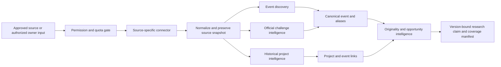

# Provider-independent source intelligence architecture

Status: design only. All automated source connectors and the ingestion Worker remain disabled. The existing M1 D1 schema and `/api/v1` contracts are unchanged.

## Four distinct layers



**A. Event discovery:** Aggregate permitted event leads from multiple platforms. Keep each source listing and its observed deadline, region, mode, and status. Resolve an event using a verified organizer URL where available, then source event IDs, normalized title, organizer, place, and date with human review for ambiguous matches. Store aliases and conflicts. An aggregator listing cannot upgrade an event to verified-official.

**B. Official challenge intelligence:** Capture organizer-confirmed problem statements, tracks, mandatory technology, eligibility and geography, judging rubric, submission requirements, prizes, workshops, deadlines, supported technologies, and revisions. Attribute every field to an exact organizer document snapshot and observation time. Conflicting revisions coexist until a reviewer chooses the current effective version. User-supplied briefs remain labeled user-supplied unless corroborated.

**C. Historical project intelligence:** Normalize approved submission records separately from repository records. A project can link to multiple events or tracks, but the link needs its own source evidence. Prize and finalist labels require a cited organizer or platform result record. A GitHub repository contributes implementation evidence and may remain an unverified candidate match.

**D. Originality and opportunity intelligence:** Extract problem, beneficiary, mechanism, technology, and operating context from an immutable idea version. Search only approved corpora, preserve query and coverage manifests, compare retrieved projects, and produce cited overlap explanations. Distinguish observed overlap, plausible analogy, and unknown coverage. No-match results do not establish novelty.

## Proposed connector boundary

The interface below is a design contract, not runtime code. All payload names use snake_case. `collect` is available only after a dated permission record and an environment-specific enablement decision.

```ts
type SourceStream = 'event_lead' | 'official_snapshot' | 'project_record' | 'research_record';
type CollectionRequest = {
  connector_id: string;
  permission_version: string;
  stream: SourceStream;
  cursor?: string;
  since?: string;
  request_budget: number;
};
type SourceEnvelope = {
  source_id: string;
  external_id: string;
  canonical_url: string;
  publisher: string;
  observed_at: string;
  published_at?: string;
  content_hash: string;
  attribution: string;
  permission_version: string;
  visibility: 'public' | 'restricted' | 'owner_supplied';
  record_kind: SourceStream;
  normalized_json: unknown;
};
type CollectionPage = {
  records: SourceEnvelope[];
  next_cursor?: string;
  rate_limit_remaining?: number;
  retry_after_seconds?: number;
  coverage: { queried_scope: string; observed_count: number; errors: string[] };
};
```

The permission gate checks host allowlist, credential reference, approved purpose and fields, retention deadline, request budget, status, and version before dispatch. It rejects unapproved scopes and records a structured error. Connector code cannot override permission status. Every page is size-bounded and idempotent by source ID, external ID, and content hash. A suspended source stops new reads and quarantines affected claims for review, while preserving a revocation audit record.

The [bounded access probes](ACCESS_PROBE_RESULTS.md) require the registry to store `technical_access_status` separately from `integration_authorization_status`. A working public feed may remain disabled for commercial use. Register HackList's feed and community MCP as distinct access methods under one source identity, including the MCP's page-fallback capability. A production adapter must fail closed if a feed request fails unless a separately approved fallback has its own request cap. Store `generated_at` or equivalent source time separately from observation time. Brabble RSS item `pubDate` may represent a deadline, so map date fields only after source-specific validation. Normalize ambiguous prize text and duplicate relationships without converting them into verified cash or organizer claims.

## Existing D1 reuse and proposed migration

`source_connectors` already carries status, host, access method, terms, permission evidence, and rate budget. `source_records` carries kind, URL, content hash, permission status, fetch/check times, and metadata. `hackathons`, `event_snapshots`, and `tracks` support canonical events and revised briefs. `public_projects` holds a single source-backed project row and optional event link. `research_claims` binds evidence to an immutable `idea_versions` row. `scorecards` and `blueprints` hold coverage status and source manifests. These are useful M1 anchors but do not yet represent multi-source provenance and many-to-many relations directly.

Propose a reviewed M2B migration, with no change applied here:

| Proposed table or field | Reason and key constraint |
| --- | --- |
| `source_permissions` | Immutable approval versions with purpose, allowed fields, commercial-use basis, attribution, retention, reviewer, effective and expiry times, and credential reference. Unique connector/version. |
| `source_observations` | Append-only normalized snapshot keyed by connector, external ID, content hash, and observed time; preserve raw-content storage policy and deletion deadline. |
| `external_entities` and `entity_aliases` | Canonical platform identifiers and URLs for events, tracks, projects, and repositories. Unique source/entity-kind/external-ID; aliases never replace source IDs. |
| `event_source_links` and `project_event_links` | Many-to-many evidence-backed relations with confidence and reviewer state; require source observation ID. |
| `project_snapshots` and `project_repositories` | Versioned project facts, visibility, award assertions, and separately evidenced repository associations. |
| `source_claim_evidence` | Many-to-many claim to observation links with field path and supporting or conflicting role; keep `research_claims.idea_version_id` intact. |
| `query_manifests` | Immutable search scope, source versions, query hashes, cursor range, result counts, errors, and unavailable corpora per idea version. |
| `source_revocations` | Suspension, takedown, deletion disposition, and affected-record audit, without retaining forbidden content. |

Use D1 foreign keys, uniqueness, status checks, bounded JSON schemas, and indexed owner-scoped joins in the eventual migration. Backfill must preserve M1 record IDs and contracts. Do not infer official status from a connector name: the actual observation publisher and approval determine claim status. Private user records and public source corpora remain in separate access paths. Migration, API additions, and any connector activation require later authorization.

## Safety and failure boundaries

External text is data, never system instruction. Strip active markup, normalize U+2014, validate URL hosts and MIME types, cap bytes and redirects, and keep credentials in environment secrets. Handle 401, 403, 429, timeout, drift, deletion, and permission expiry by pausing that connector. Preserve existing owner scope, Queue idempotency, and lease fencing. Do not log private project content or raw credentials. Apply retention and attribution rules to cache, embeddings, search indexes, exports, and backup deletion, not only the source table.
